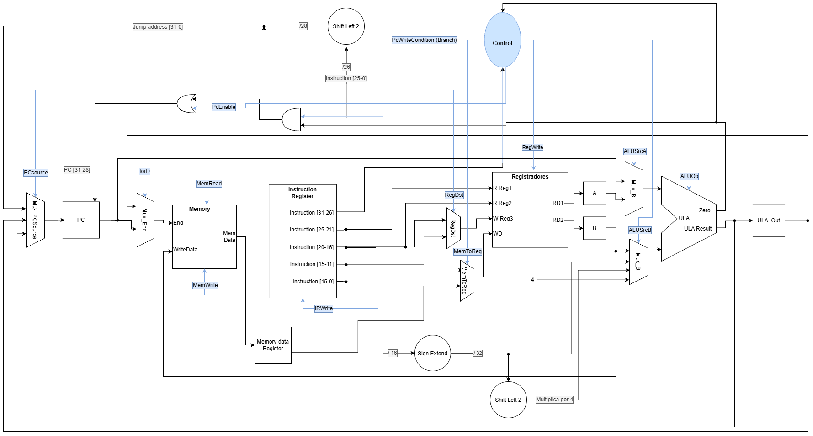
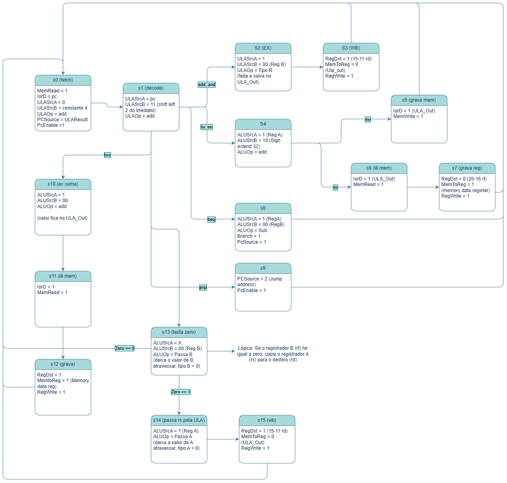
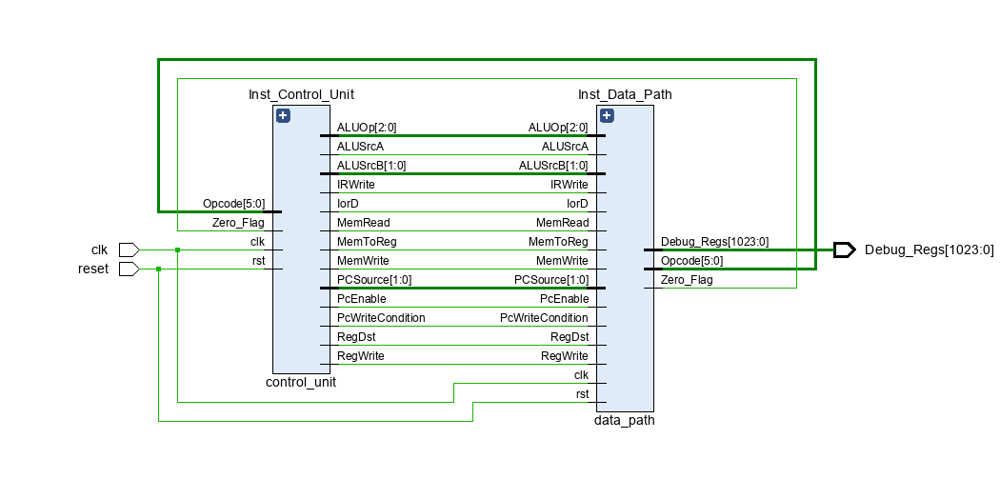

<p align="center">
  
  
  
  
</p>

**Implementação didática de um processador multiciclo baseado na arquitetura MIPS de 32 bits**

Projeto desenvolvido para a disciplina de Organização de Computadores na Universidade Estadual do Rio Grande do Sul (UERGS).

**Linguagem:** VHDL (Modelagem de hardware, simulação e síntese via Xilinx Vivado).

---

## Sumário

1. [Resumo](#1-resumo)
2. [Objetivos](#2-objetivos)
3. [Visão geral da arquitetura](#3-visão-geral-da-arquitetura)
4. [Fundamentação teórica (ISA e Modos de Endereçamento)](#4-fundamentação-teórica)
5. [Desenvolvimento: linha do tempo do projeto](#5-desenvolvimento-linha-do-tempo-do-projeto)
6. [Mapeamento de Hardware e Caminho de Dados](#6-mapeamento-de-hardware)
7. [Estrutura do repositório](#7-estrutura-do-repositório)
9. [Como reproduzir o projeto (Tutorial Vivado)](#8-como-reproduzir-o-projeto)
10. [Programa de Teste e Validação](#9-programa-de-teste-e-validação)
11. [Limitações conhecidas e trabalhos futuros](#10-limitações-conhecidas-e-trabalhos-futuros)
12. [Considerações finais](#11-considerações-finais)

---

## 1. Resumo

Este trabalho implementa um processador RISC multiciclo baseado no MIPS de 32 bits. Diferente de um processador de ciclo único, onde cada instrução precisa ser executada em um único pulso de clock (o que exige um clock muito lento), a arquitetura multiciclo divide a execução das instruções em várias etapas menores (3 a 5 ciclos). Isso permite compartilhar componentes físicos (como a memória e a ULA) em momentos diferentes, economizando hardware. 

O projeto foi inteiramente descrito em VHDL e conta com 8 instruções implementadas, sendo 6 do conjunto básico do MIPS e 2 instruções "complexas" criadas especificamente para este trabalho. O material aqui presente foi estruturado para servir de guia de estudos, ajudando alunos que estão tendo o primeiro contato com arquitetura de computadores, VHDL e a ferramenta Vivado.

## 2. Objetivos

* Compreender na prática o funcionamento de uma CPU (Unidade de Controle + Caminho de Dados).
* Implementar o ciclo de busca, decodificação e execução de instruções em VHDL.
* Projetar uma Máquina de Estados Finita (FSM) complexa para gerenciar os sinais de controle.
* Implementar instruções customizadas (`lwx` e `cmovz`) estendendo o ISA básico.
* Fornecer um ambiente de simulação fácil de reproduzir para fins didáticos.

## 3. Visão geral da arquitetura

O processador segue o modelo de **Arquitetura de Von Neumann**, utilizando uma única memória de 32 bits compartilhada tanto para armazenar o código (instruções) quanto para os dados lidos e gravados pelo programa. 

O sistema é dividido em três blocos principais de hardware estrutural:

```
 Caminho de Dados (Datapath)        Unidade de Controle (FSM)         Memória Principal
 ---------------------------        -------------------------         -------------------------
 PC, Registradores de uso geral     Máquina de Estados de 16          Memória RAM de 256
 (32x32), ULA, Muxes, IR,           estados (S0 a S15).               palavras (32 bits).
 MDR, etc.                                                            
                                    Recebe o Opcode e a flag Zero.    Armazena o programa a
 Realiza as operações               Gera os sinais para os Muxes,     ser executado e os dados.
 matemáticas e tráfego de           escrita em registradores,         (MemRead, MemWrite).
 dados.                             memória e ULA.
```

O componente **TopLevel** atua conectando o Caminho de Dados à Unidade de Controle, abstraindo toda a complexidade interna do processador.

Clique nas imagens para expandi-las: 
<table>
  <tr>
    <td align="center"><b>Datapath</b></td>
    <td></td>
  </tr>
  <tr>
    <td align="center"><b>Caminho de Dados (FSM)</b></td>
    <td></td>
  </tr>
  <tr>
    <td align="center"><b>Esquemático gerado pelo Vivado</b></td>
    <td></td>
  </tr>
</table>


## 4. Fundamentação teórica

### 4.1 Conjunto de Instruções (ISA)

O processador possui 32 registradores de uso geral (`$0` a `$31`), acessados por 5 bits, e um conjunto de 8 instruções de tamanho fixo (32 bits), seguindo o formato Big Endian:

**Instruções Básicas:**
* `add` (Tipo R): Soma aritmética entre dois registradores (`rd = rs + rt`).
* `and` (Tipo R): Operação lógica AND bit a bit (`rd = rs AND rt`).
* `lw` (Tipo I): Carrega uma palavra da memória para o registrador (`rt = Memory[rs + offset]`).
* `sw` (Tipo I): Grava o valor de um registrador na memória (`Memory[rs + offset] = rt`).
* `beq` (Tipo I): Desvio condicional. Se `rs == rt`, pula para `PC = PC + 4 + (offset * 4)`.
* `j` (Tipo J): Salto incondicional para endereço especificado.

**Instruções Complexas (Customizadas):**
* `lwx` (Load Word Indexed - Tipo R): O endereço da memória é a soma direta de dois registradores, sem imediato (`rd = Memory[rs + rt]`).
* `cmovz` (Conditional Move if Zero - Tipo R): Se `rt == 0`, copia o valor de `rs` para `rd`. Caso contrário, não faz nada.

### 4.2 Modos de Endereçamento

Para suportar essas instruções, implementamos cinco modos de endereçamento:
1. **Por Registrador:** Operandos vêm diretamente do banco (`add`, `and`, `cmovz`).
2. **Base + Deslocamento:** Registrador base somado a um offset de 16 bits estendido (`lw`, `sw`).
3. **Indexado por Registrador:** Endereço é a soma de um registrador base e um registrador de índice (`lwx`).
4. **Relativo ao PC:** Endereço alvo = `(PC + 4) + (offset * 4)` (`beq`).
5. **Pseudodireto:** Concatena os bits superiores do PC com os 26 bits da instrução deslocados (`j`).

### 4.3 Unidade de Controle (FSM do tipo Moore)

A FSM (Máquina de Estados) possui 16 estados (`S0` a `S15`). Todas as instruções começam obrigatoriamente no ciclo de *Fetch* (`S0`) e decodificação (`S1`). Após isso, a máquina ramifica de acordo com o `Opcode` lido:
* Instruções R (`add`, `and`) usam `S2` e `S3`.
* Acesso à memória usa `S4`, e ramifica para `S5` (`sw`) ou `S6` e `S7` (`lw`).
* E assim por diante. A instrução `cmovz`, por exemplo, usa os estados `S13`, `S14` e `S15` e conta com uma avaliação síncrona da flag "Zero" vinda da ULA no meio de sua execução para decidir se grava ou aborta.

## 5. Desenvolvimento: linha do tempo do projeto

Construir uma CPU não é algo que se faz "de uma vez". O projeto seguiu uma ordem lógica de implementação e testes:

1. **ULA e Registradores:** A ULA foi feita com suporte inicial apenas a ADD e SUB. O Banco de Registradores foi projetado para leitura assíncrona/combinacional e escrita síncrona (na borda de subida).
2. **Memória de Instruções/Dados:** A RAM foi modelada com 256 posições (por limites didáticos) e já preenchida no sinal de *Reset* com um pequeno programa em linguagem de máquina para testes.
3. **Integração do Datapath:** PC, Instruction Register (IR), Memory Data Register (MDR), extensores de sinal (Sign Extend) e deslocadores (Shift Left 2) foram instanciados em um único arquivo interligados por MUXes.
4. **Criação da Unidade de Controle:** A FSM foi escrita e mapeada a partir do diagrama de estados. Nesse ponto, o MIPS executava o subconjunto básico.
5. **Adoção das Instruções Complexas (lwx e cmovz):** Aqui o hardware precisou ser adaptado. A ULA ganhou operações "PASS A" e "PASS B" (deixar o valor atravessar sem alterar) para o `cmovz` poder checar se `rt` era zero e passar `rs` adiante. A FSM ganhou os estados S10-S12 (`lwx`) e S13-S15 (`cmovz`).

## 6. Mapeamento de Hardware e Caminho de Dados

O componente principal (`data_path.vhd`) interliga os elementos. Alguns destaques de como o hardware lida com as restrições físicas:
* **Uso único da ULA:** Como a ULA é usada para somar PC+4 (S0), calcular saltos (S1), calcular endereços (S4, S10) e operações aritméticas (S2), os operandos dela são selecionados por Muxes ( `ALUSrcA` e `ALUSrcB`), controlados diretamente pela FSM.
* **Saída Debug:** Para facilitar o monitoramento na simulação (já que não há LED ou display físico neste nível), o Banco de Registradores expõe um sinal `Debug_Regs` de 1024 bits (32 registradores x 32 bits), que é elevado até o Testbench.

### 6.1 Síntese e Utilização de Hardware (Relatório do Vivado)

Para fins de avaliação estrutural e validação do RTL, abaixo estão os principais dados de utilização de hardware (Slice Logic) extraídos do relatório de síntese:

* **Slice LUTs (Look-Up Tables):** 3.473 de 17.600 disponíveis (19,73%)
* **Slice Registers (Flip-Flops):** 9.497 de 35.200 disponíveis (26,98%)
* **F7 Muxes:** 1.312 de 8.800 disponíveis (14,91%)
* **F8 Muxes:** 512 de 4.400 disponíveis (11,64%)
* **DSPs e Block RAMs:** 0% (O projeto fez uso estrito de lógica combinacional e registradores padrão, sem inferir blocos de RAM dedicados da FPGA)

**Nota sobre a superutilização de pinos (IOB):** O relatório apontou o uso de 1.026 pinos de I/O (Bonded IOB), o que representa 1900% da capacidade da placa. Esse comportamento é esperado, visto que o barramento de debug `Debug_Regs` expõe todos os registradores simultaneamente (32 registradores de 32 bits = 1024 bits) para a raiz do *TopLevel* a fim de facilitar a visualização na simulação. Em uma implementação física real, esse sinal de debug seria removido, mantendo o design dentro dos limites de pinos físicos da placa.

### 6.2 Monitoramento de Registradores (`Debug_Regs`)

Durante o desenvolvimento e a avaliação do processador (especialmente para fins didáticos), é fundamental conseguir visualizar o estado interno do Banco de Registradores a cada ciclo de clock. Normalmente, em VHDL, sinais declarados internamente em componentes inferiores (como o tipo *array* de registradores dentro do `banco_registradores.vhd`) ficam encapsulados e não aparecem facilmente na raiz da simulação do nível superior.

Para resolver isso de forma elegante e facilitar a depuração e a correção, foi implementado o sinal `Debug_Regs`. Ele funciona da seguinte maneira:

1. **No Banco de Registradores (`banco_registradores.vhd`):** Um laço `for` (`gen_debug`) mapeia continuamente o conteúdo dos 32 registradores de 32 bits para uma única saída achatada de 1024 bits (`std_logic_vector(1023 downto 0)`).
2. **Propagação estrutural:** Esse vetor gigante atravessa a hierarquia, saindo do `banco_registradores.vhd` para o `data_path.vhd`, e do Datapath para a saída do processador no `TopLevel.vhd`.
3. **No Testbench (`testbench.vhd`):** O vetor de 1024 bits é recebido e reconvertido automaticamente em um *array* visualmente limpo de 32 posições de 32 bits, chamado `Reg_Debug`.

**O resultado prático:** Ao rodar a simulação no Vivado, não é necessário abrir e "cavar" a hierarquia de blocos no menu *Scopes* para procurar a matriz do banco. O array `Reg_Debug` já aparece desmembrado na tela principal do *Waveform*, permitindo auditar instantaneamente o valor de todos os registradores (`$0` a `$31`) e confirmar visualmente a execução correta das instruções.

## 7. Estrutura do repositório

| Arquivo VHDL | Descrição |
| ----- | ----- |
| `TB_TopLevel.vhd` | *Testbench*. É o arquivo que "simula" o tempo, gerando o sinal de clock e acionando o reset inicial. |
| `TopLevel.vhd` | A "Placa-Mãe". Instancia e conecta o Controle com o Caminho de Dados. |
| `control_unit.vhd` | Unidade de Controle. Contém a Máquina de Estados Finita (S0 a S15). |
| `data_path.vhd` | Caminho de Dados. Instancia Memória, Registradores, ULA e Muxes. |
| `banco_registradores.vhd` | (*Reg_File*) Matriz de 32 registradores e saídas de leitura/escrita. |
| `ula.vhd` | Unidade Lógica e Aritmética. Realiza os cálculos ditados pelo Controle. |
| `memoria.vhd` | (*Mem*) Memória unificada. Contém o programa de teste (código de máquina). |

## 8. Como reproduzir o projeto

Se você nunca usou o Xilinx Vivado ou não é familiar com VHDL, siga este passo a passo para ver o processador funcionando no seu computador.

### 8.1 Ferramentas necessárias

* Faça o download e instalação do **Xilinx Vivado** (A versão utilizada durante o projeto foi a `2020.2`, mas a versão gratuita *Vivado ML Standard Edition* mais recente funcionará perfeitamente).
* Git (opcional, para clonar o repositório).

### 8.2 Criando o projeto no Vivado

1. Abra o Vivado e clique em **Create Project**.
2. Clique em *Next*. Dê um nome ao projeto (ex: `Processador_MIPS`) e escolha um local.
3. Escolha **RTL Project** e marque a caixa *Do not specify sources at this time*.
4. Na tela *Default Part*, você precisa escolher um modelo de FPGA. O projeto foi sintetizado para a `xc7z010iclg225-1L` (Zynq-7000), mas como só vamos fazer **simulação**, qualquer placa genérica serve (ex: família Artix-7). Selecione uma e clique em *Finish*.

### 8.3 Adicionando os arquivos

1. No painel à esquerda, em *Project Manager*, clique em **Add Sources**.
2. Escolha **Add or create design sources** e clique em *Next*.
3. Clique em **Add Files** e selecione todos os arquivos `.vhd` do repositório, **EXCETO** o `TB_TopLevel.vhd`. Clique em *Finish*.
4. Repita o passo 1, mas agora escolha **Add or create simulation sources**. 
5. Adicione o arquivo `TB_TopLevel.vhd`.
6. Aguarde alguns segundos. No painel *Sources*, a hierarquia será atualizada. O `TB_TopLevel` deve ficar no topo em *Simulation Sources*, e instanciará o `TopLevel` automaticamente.

### 8.4 Rodando a simulação

1. No painel esquerdo, clique em **Run Simulation** -> **Run Behavioral Simulation**.
2. A tela preta de ondas (Waveform) será aberta.
3. No painel *Objects* (janela do meio), você verá os sinais do Testbench (`clk`, `reset`, `Reg_Debug`).
4. Clique com o botão direito na engrenagem superior da tela de ondas e ajuste o formato de visualização para **Radix -> Hexadecimal** ou **Unsigned Decimal** para facilitar a leitura.
5. Clique no botão **Run All** (ícone de "Play" com um timer) no menu superior, ou aperte `Shift + F5`.
6. Para visualizar a execução, expanda o vetor `Reg_Debug`. Você verá, ciclo a ciclo, os registradores mudando de valor conforme as instruções são executadas na memória!

<b>Essa é a simulação do projeto. Você pode acrescentar mais coisas à simulação, mudar a cor, etc.</b>


## 9. Programa de Teste e Validação

O código do programa simulado já está "queimado" dentro do arquivo `memoria.vhd`. O programa foi pensado para testar todas as 8 instruções do processador. O que esperar durante a simulação:

* As posições de memória de dados 160 e 164 contêm valores hexadecimais para teste.
* `$1` recebe o valor do endereço 160 (`lw`).
* `$2` recebe o valor do endereço 164 (`lw`).
* `$3` recebe a soma `$1 + $2` (`add`).
* `$4` recebe o AND lógico entre `$1` e `$2` (`and`).
* A instrução `sw` salva o resultado armazenado em `$3` na memória (endereço 168).
* Ocorre o teste da instrução indexada (`lwx`), trazendo um dado do endereço base apontado por `$1` deslocado por `$4`.
* O processador testa o `cmovz` condicionalmente: primeiro com falha (não grava o registrador), depois com acerto.
* Ao final do programa (endereço 14), o processador entra em um laço infinito usando a instrução `j 14` (Jump).

Ao rodar a simulação no Vivado por cerca de `550 ns` (tempo programado no *Testbench*), você verá o PC estabilizar e o banco de registradores ser preenchido com os resultados exatos dessa sequência de código.

## 10. Limitações conhecidas e trabalhos futuros

Como se trata de uma implementação acadêmica, existem limitações claras que não estão presentes em processadores comerciais:

* **Ausência de Pipeline:** O processador executa uma instrução por vez até o fim (multiciclo clássico). Não há sobreposição de instruções (pipelining).
* **Ausência de tratamento de exceções:** Divisão por zero, overflow aritmético ou acessos inválidos de memória não geram *traps* de sistema, comportamento será indefinido ou resultará em lixo na saída.
* **Memória pequena:** Devido às limitações de espaço nos arrays do VHDL para rápida simulação, a memória comporta apenas 256 endereços mapeados e não aceita grandes matrizes de dados. 

## 11. Considerações finais

Desenvolver um processador do zero, mesmo que didático, requer muita atenção aos caminhos críticos e aos conflitos de hardware (múltiplas unidades querendo acesso aos mesmos barramentos).

A grande lição aprendida foi a importância da Unidade de Controle e de projetá-la com base num diagrama de Máquina de Estados sólido. No início do desenvolvimento, falhas na escrita ou atrasos de 1 ciclo no registrador de instrução geravam bugs difíceis de rastrear. O uso da abordagem hierárquica no VHDL, testando o Banco de Registradores primeiro, a ULA depois, para só então juntar tudo, foi a metodologia que garantiu o funcionamento do sistema final.
